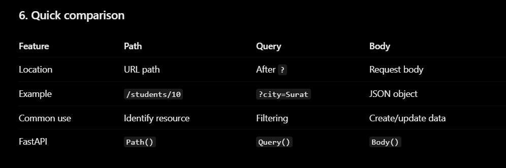
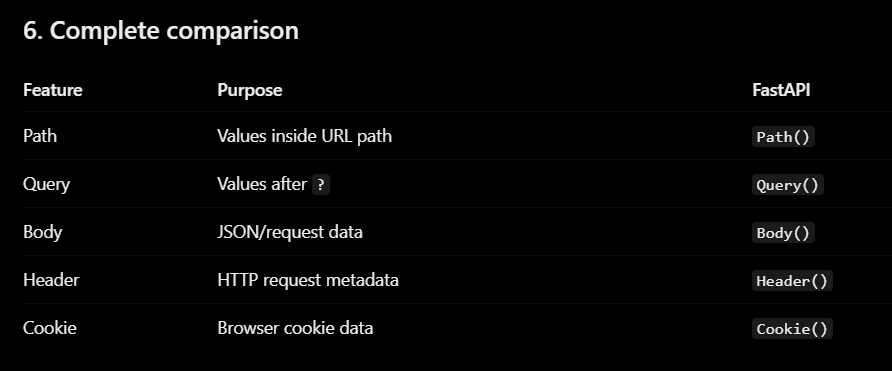
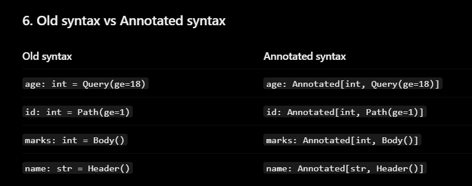
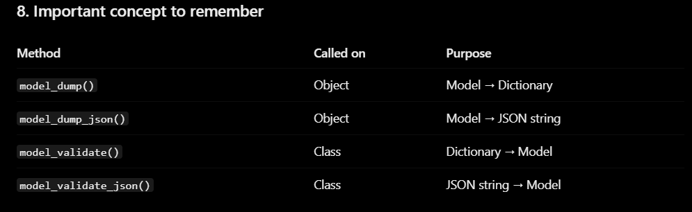
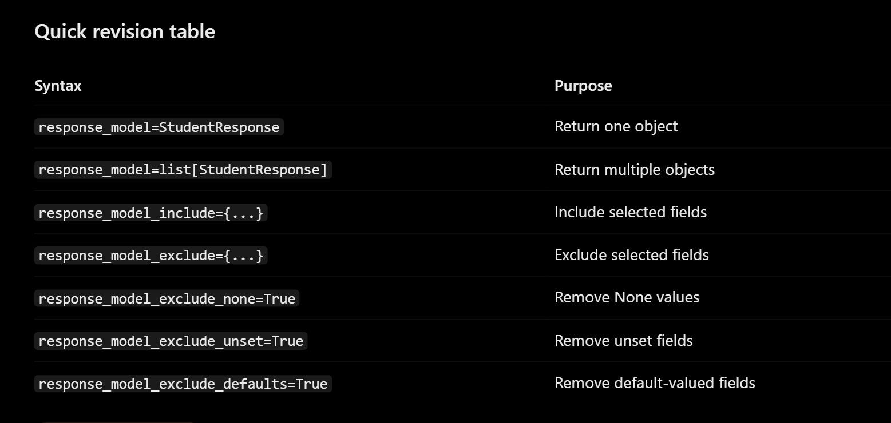
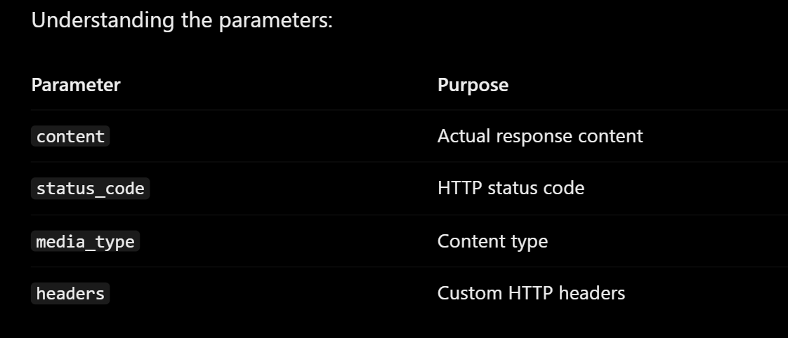

app = FastAPI() -> app is the fats api object 

@app.get("/products") -> .get Handles HTTP GET requests 
                      -> /products denotes the url of get request 

def products():
    return{"products": ["Product 1", "Product 2", "Product 3"]}  -> this is the response of fastapi sends to user 

==================================================================
Introduction To API
==================================================================

A. GET – Retrieve data

B. POST – Create new data

C. PUT – Update existing data

D. PATCH – Partially update data

E. DELETE – Delete data

===> Parameters

1. Path Parameters
A Path Parameter is a value passed directly inside the URL path.
http://127.0.0.1:8000/students/10

3. Query Parameters
A Query Parameter is a value passed after the ? symbol in a URL.
/students?city=Ahmedabad&age=19

student_id: int = 101 -> by default parameter if not given by user this is used to get data 
city: str | None = None -> none is allowed in this case 

1. Receiving JSON using Pydantic BaseModel
    def create_student(student: Student): by using this BaseModel we can get data from frontend in json formate 

2. Using Body() directly
    def get_marks(marks: int = Body()): by using this body() we can directly get the data from frontend 

=> Nested BaseModel 

class Marks(BaseModel):
    maths: int
    physics: int
    chemistry: int

class Student(BaseModel):
    name: str
    roll_no: int
    marks: Marks

Note := if we want to do like phone number isoptional so we can do phone: str | None = None 

=> HTTP headers.

Headers are additional information sent along with an HTTP request.

async function sendData() {
  const response = await fetch("http://localhost:8000/read-header/", {
    method: "GET", // Change to "POST" if sending a body payload
    headers: {
      "x-custom-token": "my-super-secret-token",
      "Content-Type": "application/json" // Required if sending a JSON body
    },
    // body: JSON.stringify({ key: "value" }) // Uncomment for POST/PUT requests
  });

  const data = await response.json();
  console.log(data);
}

===> this is how we have to send data to this fastAPI server 

=> Cookie() in FastAPI

A cookie is a small piece of information stored by the browser and sent back to a website with later requests.

Session management
Remembering preferences
Tracking login sessions

 comparision of all methods 

Part 5: Annotated

Annotated[BaseType, Metadata1, Metadata2, ...] this is the basic syntax of this Annotated 

Old Syntax VS New Syntax using Annotated

===> default_factory

class Post(BaseModel):
    title: str
    # Generates a brand-new empty list for every post
    tags: list[str] = Field(default_factory=list)
    # Generates a brand-new empty dictionary for metadata
    metadata: dict[str, str] = Field(default_factory=dict)

ConfigDict

Let's understand:
- model_config is a special class attribute recognized by Pydantic.
- ConfigDict() defines configuration options.
- extra="forbid" rejects fields that aren't defined in the model.
Now if someone sends the unknown field, Pydantic returns a validation error.
3. Three important extra-field settings
This is important for API development.
Setting	Behavior
extra="ignore"	Ignores extra fields (default)
extra="forbid"	Rejects extra fields
extra="allow"	Accepts and stores extra fields

 model_config = ConfigDict(
        extra="whatever you want from those 3"
    )

model_config = ConfigDict(strict=True) => With strict mode, a string "19" is rejected because the field expects an integer. but normaly pydantic model convert "19" into 19

model_config = ConfigDict(validate_assignment=True) => student = Student(age=19) student.age = "hello" With validate_assignment=True, Pydantic validates the assignment and rejects it.

Populate by field name => model_config = ConfigDict(populate_by_name=True) , student_name: str = Field(alias="name") => it 

 this is part of response model